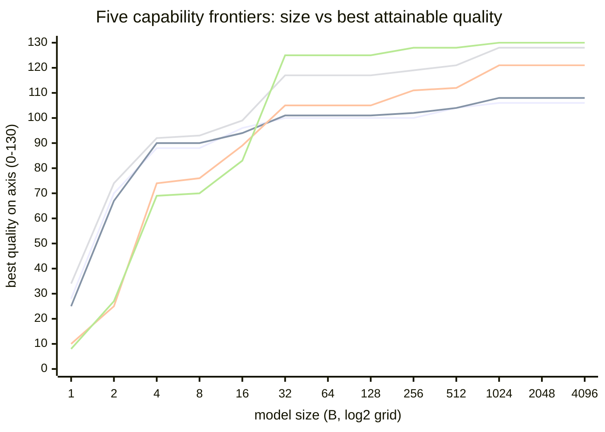

# Roster Pareto Analysis

How the candidate pool spreads across **size** (parameters) and **capability** (the 5 `qualityBy` axes), and the
**frontier-tolerance gate** that turns it into the active roster.

The pool is every open-weight checkpoint with an architecture record (`data/model-arch.json`): **135 candidates**
(52 hand-authored in `src/sim/content.ts` + 83 generated by `scripts/gen-roster.mjs`). A
**6% frontier-tolerance gate** (`withinFrontierTolerance`, `src/sim/calibrate.ts`) keeps **58 active**
checkpoints — the ones the player owns and deploys.

Every number below is computed from the *actual loaded roster* (`MODEL_CANDIDATES` / `MODEL_DEFS`, calibrated by
`src/sim/calibrate.ts`) by `node scripts/roster-report.mjs pareto`. A **frontier** is the (minimize size, maximize
quality) upper envelope: at each size, the best quality attainable on that axis by a model no larger.

---

## 1. The five capability frontiers

Evaluated on a log₂ size grid (1 → 4096 B) over the full pool:
`frontier(size) = max quality over all candidates with paramsTotalB ≤ size`.

`xychart-beta` has no legend; the five `line` series, in declaration order, are:

| # | axis | ≤1B | ≤32B | ≤4096B | the models that set the frontier as size grows |
|---|------|----:|-----:|------:|----------------------------------------------|
| 1 | **chat** | 28 | 100 | 106 | Qwen3 0.6B (28) → K2 Horizon 0.9B (43) → LFM2.5-1.2B-Thinking (69) → Qwen3.5 2B (70) → MiniCPM5-2B (87) → Qwen3.5 4B (88) → Qwen3.5 9B (95) → Gemma 4 12B (96) → Gemma 4 26B A4B (97) → Qwen3.5 27B (100) → Qwen3.5-397B-A17B (101) → MiniMax-M3 428B (104) → Step 5 Preview 600B (105) → MiMo-V2.6-Pro 1.02T (106) |
| 2 | **general** | 25 | 101 | 108 | Qwen3 0.6B (23) → Qwen3.5 0.8B (25) → K2 Horizon 0.9B (35) → LFM2.5-1.2B-Thinking (45) → Exaone 4.0 1.2B (61) → Qwen3.5 2B (67) → MiniCPM5-2B (87) → Qwen3.5 4B (90) → Qwen3.5 9B (94) → Qwen3.5 27B (99) → Qwen3.8-27B (101) → Qwen3.8-Flash-Next 180B (102) → MiniMax-M3 428B (104) → Step 5 Preview 600B (108) |
| 3 | **coding** | 10 | 105 | 121 | Qwen3 0.6B (10) → K2 Horizon 0.9B (19) → LFM2.5-1.2B-Thinking (25) → MiniCPM5-2B (74) → Ling-3.0-tiny 7.9B (76) → Granite 4.2 8B (81) → Qwen3.5 9B (84) → Gemma 4 12B (89) → Qwen3.5 27B (92) → Qwen3.8-27B (105) → Qwen3.8-Flash-Next 180B (111) → GLM-5.3-Flash 321B (112) → Ling-3.1-flash 560B (114) → Step 5 Preview 600B (119) → MiMo-V2.6-Pro 1.02T (121) |
| 4 | **reasoning** | 34 | 117 | 128 | Qwen3 0.6B (29) → Qwen3.5 0.8B (34) → K2 Horizon 0.9B (41) → LFM2.5-1.2B-Thinking (44) → Exaone 4.0 1.2B (66) → Qwen3.5 2B (74) → MiniCPM5-2B (91) → Qwen3.5 4B (92) → K2-Horizon-3.7B (93) → K2-Horizon-7B (99) → Qwen3.5 27B (107) → Qwen3.8-27B (117) → Qwen3.8-Flash-Next 180B (119) → GLM-5.3-Flash 321B (120) → MiniMax-M3 428B (121) → Ling-3.1-flash 560B (122) → Step 5 Preview 600B (127) → MiMo-V2.6-Pro 1.02T (128) |
| 5 | **agentic** | 8 | 125 | 130 | Qwen3 0.6B (8) → K2 Horizon 0.9B (12) → LFM2.5-1.2B-Thinking (15) → Qwen3.5 2B (27) → MiniCPM5-2B (57) → Qwen3.5 4B (69) → K2-Horizon-3.7B (70) → K2-Horizon-7B (83) → Qwen3.6-27B (96) → Qwen3.8-27B (125) → Qwen3.8-Flash-Next 180B (128) → Step 5 Preview 600B (129) → MiMo-V2.6-Pro 1.02T (130) |

---

## 2. Per-size-bucket capability ceilings

The best quality on each axis **within** each size bucket (all candidates):

| bucket | candidates | active | chat | general | coding | reasoning | agentic |
|--------|-----------:|-------:|----:|----:|----:|----:|----:|
| ≤4B | 24 | 10 | 88 | 90 | 74 | 92 | 69 |
| 4–15B | 27 | 8 | 96 | 94 | 89 | 99 | 83 |
| 15–40B | 26 | 11 | 100 | 101 | 105 | 117 | 125 |
| 40–120B | 15 | 2 | 97 | 95 | 90 | 104 | 92 |
| 120–400B | 18 | 15 | 101 | 102 | 112 | 120 | 128 |
| 400B–1T | 20 | 8 | 105 | 108 | 119 | 127 | 129 |
| >1T | 5 | 4 | 106 | 108 | 121 | 128 | 130 |

**Capability compression:** the best 15–40B checkpoint matches or beats the whole 40–120B band on every axis
(chat 100 vs 97, general 101 vs 95, coding 105 vs 90, reasoning 117 vs 104, agentic 125 vs 92) — stacking parameters in that band buys
nothing, and the ceiling moves only with the multi-hundred-billion MoEs. The gate below keeps only the
checkpoints that are still a rational pick at their size.

---

## 3. The active roster — the 6% frontier-tolerance gate

A checkpoint stays iff, **on at least one capability axis, its quality is within 6% of the frontier at
its size** (`ROSTER_FRONTIER_TOLERANCE = 0.06`). A model is dropped only when it trails the frontier by more than
6% on every axis — strictly beaten by something no bigger, on all five lanes. The gate trims **135
candidates → 58 active**, spanning 0.6B → 2.78T. The default starter
(`DEFAULT_MODEL_ID`) is the smallest dense, non-thinking active model: **Qwen3.5 0.8B**.

| model | size (total / active) | chat / general / coding / reasoning / agentic | attention | KV per token (+ per request) | release precision | thinks |
|-------|----------------------|-----------------------------------------------|-----------|------------------------------|-------------------|-------:|
| Qwen3 0.6B | 0.6B / 0.6B | 28 / 23 / 10 / 29 / 8 | GQA | 112.0 KB (+0 MB) | BF16 (2 B/param) | 1500 |
| Qwen3.5 0.8B | 0.8B / 0.8B | 28 / 25 / 9 / 34 / 8 | hybrid-linear | 12.0 KB (+20 MB) | BF16 (2 B/param) | — |
| Gemma 3 1B Instruct | 1B / 1B | 21 / 21 / 8 / 27 / 8 | hybrid-swa | 4.0 KB (+12 MB) | BF16 (2 B/param) | — |
| K2 Horizon 0.9B | 1.08B / 1.08B | 43 / 35 / 19 / 41 / 12 | GQA | 56.0 KB (+0 MB) | BF16 (2 B/param) | 1500 |
| LFM2.5-1.2B-Thinking | 1.17B / 1.17B | 69 / 45 / 25 / 44 / 15 | hybrid-linear | 12.0 KB (+0 MB) | BF16 (2 B/param) | 1500 |
| Exaone 4.0 1.2B | 1.28B / 1.28B | 44 / 61 / 23 / 66 / 8 | GQA | 60.0 KB (+0 MB) | BF16 (2 B/param) | 1500 |
| Qwen3.5 2B | 2B / 2B | 70 / 67 / 18 / 74 / 27 | hybrid-linear | 12.0 KB (+20 MB) | BF16 (2 B/param) | 2000 |
| MiniCPM5-2B | 2.52B / 2.52B | 87 / 87 / 74 / 91 / 57 | GQA | 42.0 KB (+0 MB) | BF16 (2 B/param) | 1500 |
| NVIDIA Nemotron 3 Nano 4B | 3.97B / 3.97B | 84 / 78 / 62 / 78 / 41 | hybrid-linear | 16.0 KB (+43 MB) | BF16 (2 B/param) | — |
| Qwen3.5 4B | 4B / 4B | 88 / 90 / 64 / 92 / 69 | hybrid-linear | 32.0 KB (+52 MB) | BF16 (2 B/param) | 2000 |
| K2-Horizon-3.7B | 5.06B / 5.06B | 88 / 88 / 74 / 93 / 70 | GQA | 144.0 KB (+0 MB) | BF16 (2 B/param) | 1500 |
| Ling-3.0-tiny | 7.9B / 1.3B | 88 / 88 / 76 / 92 / 67 | hybrid-linear | 6.8 KB (+20 MB) | BF16 (2 B/param) | 2000 |
| Granite 4.2 8B | 8.8B / 8.8B | 84 / 84 / 81 / 89 / 56 | GQA | 160.0 KB (+0 MB) | BF16 (2 B/param) | 2000 |
| K2-Horizon-7B | 9B / 9B | 91 / 91 / 83 / 99 / 83 | GQA | 144.0 KB (+0 MB) | BF16 (2 B/param) | 1500 |
| Qwen3.5 9B | 9B / 9B | 95 / 94 / 84 / 96 / 81 | hybrid-linear | 32.0 KB (+52 MB) | BF16 (2 B/param) | 2000 |
| Gemma 4 12B | 12B / 12B | 96 / 92 / 89 / 95 / 76 | hybrid-swa | 16.0 KB (+336 MB) | BF16 (2 B/param) | 2000 |
| Apriel-v1.6-15B-Thinker | 15B / 15B | 93 / 90 / 88 / 92 / 69 | GQA | 192.0 KB (+0 MB) | BF16 (2 B/param) | 1500 |
| Apriel-v1.5-15B-Thinker | 15B / 15B | 87 / 86 / 85 / 88 / 50 | GQA | 192.0 KB (+0 MB) | BF16 (2 B/param) | 1500 |
| gpt-oss 20B | 20.9B / 3.6B | 89 / 86 / 85 / 89 / 56 | hybrid-swa | 24.0 KB (+3 MB) | MXFP4 (0.66 B/param) | 2000 |
| Gemma 4 26B A4B | 25.2B / 3.8B | 97 / 94 / 89 / 99 / 71 | hybrid-swa | 20.0 KB (+210 MB) | BF16 (2 B/param) | 2000 |
| Qwen3.6-27B | 27B / 27B | 97 / 97 / 91 / 106 / 96 | hybrid-linear | 64.0 KB (+154 MB) | BF16 (2 B/param) | 4000 |
| Qwen3.5 27B | 27B / 27B | 100 / 99 / 92 / 107 / 96 | hybrid-linear | 64.0 KB (+154 MB) | BF16 (2 B/param) | 2000 |
| Qwen3.8-27B | 27.8B / 27.8B | 100 / 101 / 105 / 117 / 125 | hybrid-linear | 64.0 KB (+154 MB) | BF16 (2 B/param) | 2000 |
| Muse Glimmer | 29.8B / 29.8B | 97 / 97 / 94 / 107 / 98 | hybrid-swa | 13.0 KB (+82 MB) | BF16 (2 B/param) | 2000 |
| Gemma 4 31B | 30.7B / 30.7B | 99 / 98 / 98 / 106 / 99 | hybrid-swa | 80.0 KB (+839 MB) | BF16 (2 B/param) | 1736 |
| Nemotron Cascade 2 30B A3B | 31.6B / 3.2B | 96 / 90 / 89 / 91 / 74 | hybrid-linear | 6.0 KB (+49 MB) | BF16 (2 B/param) | 1500 |
| Qwen3.5 35B A3B | 35B / 3B | 98 / 97 / 90 / 103 / 86 | hybrid-linear | 20.0 KB (+64 MB) | BF16 (2 B/param) | 2000 |
| Qwen3.6 35B A3B | 35B / 3B | 95 / 96 / 89 / 104 / 92 | hybrid-linear | 20.0 KB (+64 MB) | BF16 (2 B/param) | 4000 |
| K2-Horizon-MoVA-36B-A4B | 37.4B / 4B | 94 / 95 / 91 / 105 / 95 | GQA | 192.0 KB (+0 MB) | BF16 (2 B/param) | 1500 |
| gpt-oss 120B | 117B / 5.1B | 94 / 92 / 90 / 98 / 78 | hybrid-swa | 36.0 KB (+5 MB) | MXFP4 (0.56 B/param) | 2000 |
| Nemotron-3-Super-120B-A12B | 120B / 12B | 97 / 95 / 89 / 101 / 87 | hybrid-linear | 8.0 KB (+170 MB) | BF16 (2 B/param) | 2000 |
| Qwen3.5-122B-A10B | 122B / 10B | 100 / 99 / 94 / 107 / 93 | hybrid-linear | 24.0 KB (+154 MB) | BF16 (2 B/param) | 2000 |
| Ling-3.0-flash | 124B / 5.1B | 95 / 97 / 92 / 106 / 96 | hybrid-linear | 7.9 KB (+76 MB) | BF16 (2 B/param) | 1500 |
| Qwen3.8-Flash-Next | 180B / 6B | 100 / 102 / 111 / 119 / 128 | hybrid-linear | 24.8 KB (+116 MB) | BF16 (2 B/param) | 2000 |
| MiniMax-M2.7 | 230B / 10B | 100 / 100 / 103 / 112 / 107 | GQA | 248.0 KB (+0 MB) | FP8 (1.01 B/param) | 2462 |
| MiniMax-M2 | 230B / 10B | 97 / 94 / 89 / 96 / 85 | GQA | 248.0 KB (+0 MB) | FP8 (1.01 B/param) | 2000 |
| Solar Open 2 250B | 250B / 15B | 96 / 97 / 98 / 109 / 93 | hybrid-linear | 48.0 KB (+156 MB) | BF16 (2 B/param) | 1500 |
| Inkling-Small | 276B / 12B | 98 / 100 / 104 / 114 / 106 | hybrid-swa | 28.0 KB (+74 MB) | BF16 (2 B/param) | 2000 |
| DeepSeek V4 Flash 0731 | 284B / 13B | 100 / 101 / 110 / 119 / 126 | csa | 6.7 KB (+6 MB) | FP4 (0.55 B/param) | 1500 |
| Hy3 | 295B / 21B | 99 / 100 / 104 / 115 / 114 | GQA | 320.0 KB (+0 MB) | BF16 (2 B/param) | 2000 |
| MiMo-V2.6-Flash | 309B / 15B | 99 / 100 / 108 / 116 / 116 | hybrid-swa | 22.5 KB (+26 MB) | MXFP4 (0.56 B/param) | 2000 |
| Motif 3 | 314B / 13.2B | 98 / 97 / 98 / 116 / 120 | hybrid-swa | 15.8 KB (+6 MB) | BF16 (2 B/param) | 1500 |
| GLM-5.3-Flash | 321B / 18B | 100 / 102 / 112 / 120 / 128 | hybrid-linear | 22.3 KB (+148 MB) | FP8 (1.02 B/param) | 2000 |
| K2-Horizon-375B-A23B | 379.2B / 23B | 98 / 99 / 98 / 114 / 117 | GQA | 244.0 KB (+0 MB) | BF16 (2 B/param) | 2000 |
| Qwen3.5-397B-A17B | 397B / 17B | 101 / 101 / 99 / 111 / 109 | hybrid-linear | 30.0 KB (+192 MB) | BF16 (2 B/param) | 3186 |
| Nex-N2-Pro | 397B / 17B | 98 / 100 / 97 / 116 / 114 | hybrid-linear | 30.0 KB (+192 MB) | BF16 (2 B/param) | 1500 |
| MiniMax-M3 | 428B / 23B | 104 / 104 / 105 / 121 / 117 | GQA | 120.0 KB (+0 MB) | BF16 (2 B/param) | 2000 |
| Nemotron 3 Ultra 550B-A55B | 550B / 55B | 102 / 100 / 96 / 110 / 104 | hybrid-linear | 12.0 KB (+408 MB) | BF16 (2 B/param) | 2275 |
| Ling-3.1-flash | 560B / 25B | 102 / 104 / 114 / 122 / 127 | hybrid-linear | 10.1 KB (+274 MB) | FP8 (1 B/param) | 2000 |
| Step 5 Preview | 600B / 27B | 105 / 108 / 119 / 127 / 129 | hybrid-swa | 69.0 KB (+109 MB) | FP8 (1.07 B/param) | 2000 |
| GLM-5.2 | 753B / 40B | 100 / 101 / 110 / 122 / 124 | MLA | 93.0 KB (+0 MB) | BF16 (2 B/param) | 2000 |
| GLM-5.3 | 753B / 40B | 101 / 102 / 118 / 122 / 128 | MLA | 93.0 KB (+0 MB) | FP8 (1 B/param) | 2000 |
| DeepSeek-V4.1-Flash | 763B / 16B | 102 / 103 / 112 / 121 / 127 | csa | 3.3 KB (+5 MB) | FP4 (0.66 B/param) | 2000 |
| Muse Spark Open | 816B / 42B | 100 / 100 / 117 / 122 / 127 | GQA | 248.0 KB (+0 MB) | BF16 (2 B/param) | 2000 |
| MiMo-V2.6-Pro | 1.02T / 42B | 106 / 108 / 121 / 128 / 130 | hybrid-swa | 50.0 KB (+39 MB) | MXFP4 (0.55 B/param) | 2000 |
| DeepSeek-V4-Pro-0813 | 1.6T / 49B | 101 / 102 / 111 / 122 / 127 | csa | 9.6 KB (+8 MB) | FP4 (0.54 B/param) | 2000 |
| Qwen3.8 2.4T A95B | 2.45T / 95B | 101 / 103 / 115 / 123 / 128 | hybrid-linear | 92.0 KB (+587 MB) | BF16 (2 B/param) | 2000 |
| Kimi K3 | 2.78T / 104B | 103 / 105 / 119 / 127 / 129 | hybrid-linear | 27.0 KB (+449 MB) | MXFP4 (0.56 B/param) | 2000 |

**Pruned (77)** — each trails a no-larger model by more than 6% on every axis:
LFM2 1.2B (1.17B) · Llama 3.2 1B Instruct (1.23B) · Granite 4.0 H 1B (1.5B) · Granite 4.0 1B (1.6B) · Qwen3 1.7B (1.7B) · LFM2 2.6B (2.57B) · LFM2.5-2.6B (2.69B) · Jamba Reasoning 3B (3B) · Ministral 3 3B (3.4B) · Granite 4.1 3B (3.4B) · Granite 4.0 Micro (3.4B) · Granite 4.2 3B (3.66B) · Phi-4 Mini Instruct (3.8B) · Qwen3-4B-Instruct-2507 (4B) · Gemma 3 4B Instruct (4.3B) · Gemma 4 E2B (5.1B) · Gemma 3n E2B Instruct (5.4B) · Gemma 3n E4B Instruct (7.9B) · Llama 3.1 8B Instruct (8B) · Gemma 4 E4B (8B) · Llama 3 Instruct 8B (8B) · Granite 3.3 8B (8.17B) · DeepSeek R1 0528 Qwen3 8B (8.19B) · Qwen3 8B (8.2B) · LFM2.5-8B-A1B (8.3B) · LFM2 8B A1B (8.3B) · Ministral 3 8B (8.4B) · Granite 4.1 8B (8.8B) · Nemotron Nano 9B v2 (9B) · Gemma 3 12B (12B) · Ministral 3 14B (13.5B) · Phi-4 14B (14.7B) · Qwen3 14B (14.8B) · Mistral Small 3.2 24B (24B) · Devstral Small 2 24B (24B) · LFM2 24B A2B (24B) · Gemma 3 27B (27B) · Granite 4.1 30B (28.9B) · Granite 4.2 30B (29.3B) · Qwen3 30B-A3B (30.5B) · Qwen3-Coder-30B-A3B (30.5B) · Nemotron 3 Nano 30B-A3B (31.6B) · Nemotron 3.5 Lightning (31.6B) · EXAONE 4.0 32B (32B) · Granite 4.0 H Small (32B) · Qwen3 32B (32.8B) · EXAONE 4.5 33B (33B) · G9v3-39A5B (39B) · Llama Nemotron Super 49B v1.5 (49B) · Llama 3.3 Nemotron Super 49B v1 (49B) · Llama 3.3 70B Instruct (70B) · Hermes 4 - Llama-3.1 70B (70B) · Llama 3.1 Nemotron Instruct 70B (70B) · Llama 3.1 Instruct 70B (70B) · DeepSeek R1 Distill Llama 70B (70B) · Llama 3 Instruct 70B (70B) · Qwen2.5 Instruct 72B (72.7B) · Nemotron 3.5 Bolt 74B-A9B (74.9B) · Qwen3-Next-80B-A3B Thinking (80B) · Solar Open 100B (102.6B) · GLM-4.5-Air (106B) · Qwen3 235B-A22B Thinking (235B) · Llama 3.1 Nemotron Ultra 253B v1 (253B) · ERNIE 4.5 300B A47B (300B) · Hermes 4 - Llama-3.1 405B (405B) · Llama 3.1 Instruct 405B (405B) · MiniMax M1 80k (456B) · Qwen3 Coder 480B A35B Instruct (480B) · DeepSeek-V3.1 (671B) · DeepSeek R1 0528 (671B) · DeepSeek V3 (671B) · DeepSeek V3.2 Exp (685B) · A.X-K2 (688B) · K-EXAONE 2.0 0803 (750B) · Inkling (975B) · Kimi K2 Thinking (1T) · LongCat 2.0 (1.6T).

---

## 4. Hand-authored entries vs the frontier

The hand-authored entries carry the roster's identity (recognizable lines, lineage edges, the teaching foils).
Measured against the full pool:

| model | size | on frontier (within the gate) | Pareto-optimal | active |
|-------|-----:|-------------------------------|:--------------:|:------:|
| Llama 3.2 1B Instruct | 1.23B | — | ✗ (LFM2.5-1.2B-Thinking) | — |
| MiniCPM5-2B | 2.52B | chat, general, coding, reasoning, agentic | ✓ | ✓ |
| Qwen3-4B-Instruct-2507 | 4B | — | ✗ (MiniCPM5-2B) | — |
| K2-Horizon-3.7B | 5.06B | chat, general, coding, reasoning, agentic | ✓ | ✓ |
| Ling-3.0-tiny | 7.9B | chat, general, coding, reasoning, agentic | ✓ | ✓ |
| Llama 3.1 8B Instruct | 8B | — | ✗ (Qwen3-4B-Instruct-2507) | — |
| Qwen3 8B | 8.2B | — | ✗ (Qwen3-4B-Instruct-2507) | — |
| Nemotron Nano 9B v2 | 9B | — | ✗ (MiniCPM5-2B) | — |
| K2-Horizon-7B | 9B | chat, general, coding, reasoning, agentic | ✓ | ✓ |
| Gemma 3 12B | 12B | — | ✗ (Qwen3-4B-Instruct-2507) | — |
| Phi-4 14B | 14.7B | — | ✗ (MiniCPM5-2B) | — |
| gpt-oss 20B | 20.9B | coding | ✗ (Gemma 4 12B) | ✓ |
| Mistral Small 3.2 24B | 24B | — | ✗ (gpt-oss 20B) | — |
| Devstral Small 2 24B | 24B | — | ✗ (gpt-oss 20B) | — |
| Gemma 3 27B | 27B | — | ✗ (gpt-oss 20B) | — |
| Qwen3.6-27B | 27B | chat, general, coding, reasoning, agentic | ✗ (Qwen3.5 27B) | ✓ |
| Qwen3.8-27B | 27.8B | chat, general, coding, reasoning, agentic | ✓ | ✓ |
| Qwen3 30B-A3B | 30.5B | — | ✗ (Qwen3.6-27B) | — |
| Qwen3-Coder-30B-A3B | 30.5B | — | ✗ (gpt-oss 20B) | — |
| Nemotron 3 Nano 30B-A3B | 31.6B | — | ✗ (Qwen3.6-27B) | — |
| Qwen3 32B | 32.8B | — | ✗ (gpt-oss 20B) | — |
| K2-Horizon-MoVA-36B-A4B | 37.4B | chat, general | ✗ (Qwen3.6-27B) | ✓ |
| Llama 3.3 70B Instruct | 70B | — | ✗ (gpt-oss 20B) | — |
| Qwen3-Next-80B-A3B Thinking | 80B | — | ✗ (Qwen3.6-27B) | — |
| GLM-4.5-Air | 106B | — | ✗ (Nemotron 3 Nano 30B-A3B) | — |
| gpt-oss 120B | 117B | chat | ✗ (Qwen3.6-27B) | ✓ |
| Nemotron-3-Super-120B-A12B | 120B | chat, general | ✗ (Qwen3.6-27B) | ✓ |
| Qwen3.5-122B-A10B | 122B | chat, general | ✗ (Qwen3.8-27B) | ✓ |
| Ling-3.0-flash | 124B | chat, general | ✗ (Qwen3.8-27B) | ✓ |
| Qwen3.8-Flash-Next | 180B | chat, general, coding, reasoning, agentic | ✓ | ✓ |
| Qwen3 235B-A22B Thinking | 235B | — | ✗ (Nemotron-3-Super-120B-A12B) | — |
| Solar Open 2 250B | 250B | chat, general | ✗ (Qwen3.8-27B) | ✓ |
| Inkling-Small | 276B | chat, general, reasoning | ✗ (Qwen3.8-27B) | ✓ |
| Hy3 | 295B | chat, general, reasoning | ✗ (Qwen3.8-27B) | ✓ |
| MiMo-V2.6-Flash | 309B | chat, general, coding, reasoning | ✗ (Qwen3.8-Flash-Next) | ✓ |
| Motif 3 | 314B | chat, general, reasoning | ✗ (Qwen3.8-27B) | ✓ |
| GLM-5.3-Flash | 321B | chat, general, coding, reasoning, agentic | ✓ | ✓ |
| K2-Horizon-375B-A23B | 379.2B | chat, general, reasoning | ✗ (Qwen3.8-27B) | ✓ |
| Qwen3.5-397B-A17B | 397B | chat, general | ✓ | ✓ |
| MiniMax-M3 | 428B | chat, general, reasoning | ✓ | ✓ |
| Nemotron 3 Ultra 550B-A55B | 550B | chat, general | ✗ (MiniMax-M3) | ✓ |
| Ling-3.1-flash | 560B | chat, general, coding, reasoning, agentic | ✓ | ✓ |
| Step 5 Preview | 600B | chat, general, coding, reasoning, agentic | ✓ | ✓ |
| DeepSeek-V3.1 | 671B | — | ✗ (gpt-oss 120B) | — |
| GLM-5.2 | 753B | chat, reasoning, agentic | ✗ (Ling-3.1-flash) | ✓ |
| GLM-5.3 | 753B | chat, general, coding, reasoning, agentic | ✗ (Step 5 Preview) | ✓ |
| DeepSeek-V4.1-Flash | 763B | chat, general, coding, reasoning, agentic | ✗ (Ling-3.1-flash) | ✓ |
| Muse Spark Open | 816B | chat, coding, reasoning, agentic | ✗ (Step 5 Preview) | ✓ |
| Kimi K2 Thinking | 1T | — | ✗ (Qwen3.5-122B-A10B) | — |
| MiMo-V2.6-Pro | 1.02T | chat, general, coding, reasoning, agentic | ✓ | ✓ |
| DeepSeek-V4-Pro-0813 | 1.6T | chat, general, reasoning, agentic | ✗ (Ling-3.1-flash) | ✓ |
| Kimi K3 | 2.78T | chat, general, coding, reasoning, agentic | ✗ (Step 5 Preview) | ✓ |

A dominated hand-authored entry is dominated *for real*: the cells are Artificial Analysis measurements on one
reference scale (bridged only where AA stopped publishing an eval; see `scripts/aa-cells.mjs`), so the
2024 → 2026 obsolescence the gate prunes is the same capability compression the campaign is built around.
See [REALISM-MODELS.md](REALISM-MODELS.md) for the build pipeline and [MODEL-CATALOG.md](MODEL-CATALOG.md) for the
fact-checked roster reference.
